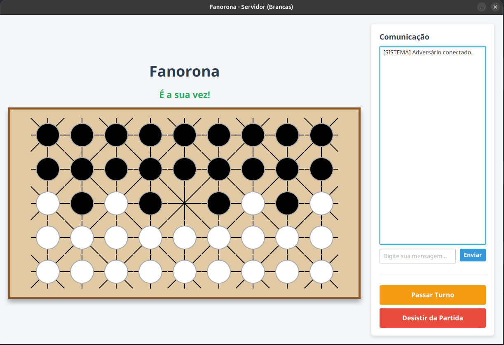
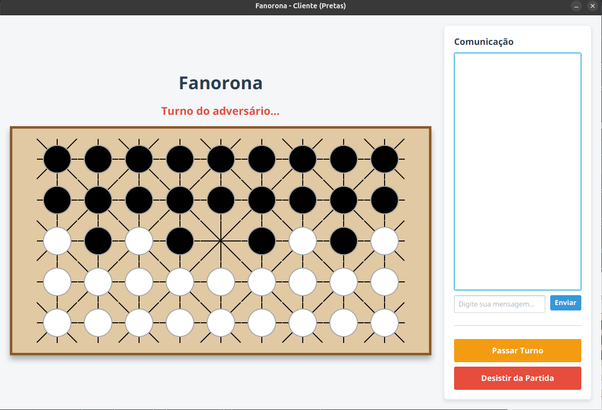

# Fanorona (gRPC + JavaFX)


Uma implementação moderna e em tempo real do jogo de tabuleiro **Fanorona**. Este projeto apresenta uma arquitetura multijogador robusta baseada em **gRPC com Streaming Bidirecional (HTTP/2)**.

## Destaques do Projeto

- **Arquitetura Client-Server**: O jogo permite que um jogador crie a partida (Servidor/Peças Brancas) e outro se conecte remotamente (Cliente/Peças Pretas).
- **Interface Gráfica**: UI construída em JavaFX com interações visuais fluidas, destaques de jogadas válidas e chat integrado em tempo real.
- **Segurança e Tipagem Forte**: Toda a comunicação de rede é validada em tempo de compilação através de contratos `.proto`.

---

## Como Compilar e Executar

### Pré-requisitos

- **Java JDK 21** ou superior.
- **Maven** (Apache Maven) instalado.

### Compilando o Projeto

Na raiz do repositório, execute:

```bash
# Limpa builds antigos, compila o contrato .proto e empacota tudo num único .jar
mvn clean package
```

### Executando a Partida

Após o *build* bem-sucedido, o arquivo final estará na pasta `target/`.

**Terminal 1 (Jogador 1 - O Servidor):**

```bash
java -jar target/fanorona-grpc-1.0-SNAPSHOT.jar
```

1. No menu pop-up, selecione **Criar Partida (Servidor)**.
2. Aguarde a mensagem `[SISTEMA] Adversário conectado.`  que chegará no painel de chat quando o adversário se conectar na partida.

<p align="center">
  
</p>

**Terminal 2 (Jogador 2 - O Cliente):**
*Num segundo terminal ou em outro computador na mesma rede local:*

```bash
java -jar target/fanorona-grpc-1.0-SNAPSHOT.jar
```

1. Selecione **Entrar (Cliente)**.
2. Insira o **IP do Servidor** (ou deixe `127.0.0.1` para testar na mesma máquina).

<p align="center">
  
</p>

---

## Regras Básicas do Fanorona Aplicadas

- **Captura por Aproximação:** Mover uma peça para um ponto vazio adjacente a uma peça inimiga (na mesma direção do movimento) captura essa peça inimiga e todas as que estiverem diretamente atrás dela.
- **Captura por Afastamento:** Mover uma peça para longe de uma peça inimiga que estava adjacente captura essa inimiga e as peças na mesma linha.
- **Cruzamentos:** Movimentos diagonais só são permitidos nos "cruzamentos fortes" (onde as linhas formam o padrão visual de uma estrela).
- **Vitória:** O jogo termina quando um jogador captura todas as peças do adversário ou em caso de desistência.

## Tecnologias Utilizadas

- **Java 21**
- **JavaFX 21** (Interface Gráfica e Controles)
- **gRPC 1.62 & Protobuf 3.25** (Comunicação e Serialização Binária)
- **Maven** (Gestão de Dependências e Build Lifecycle)